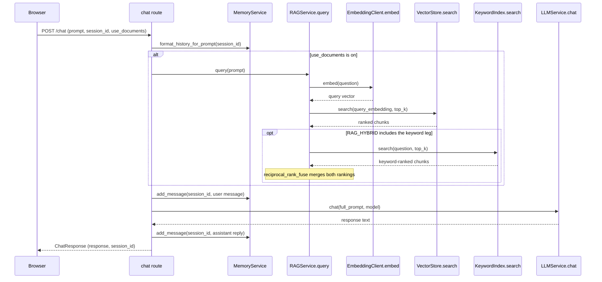
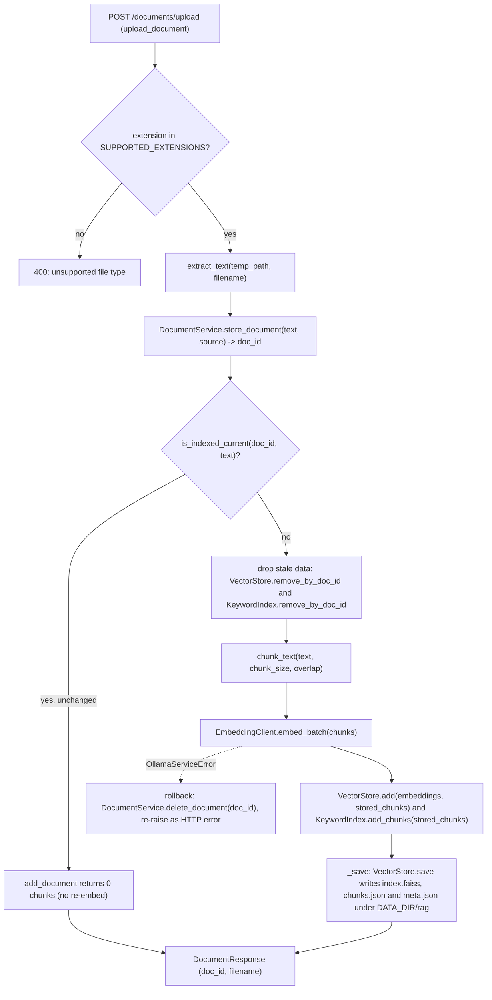

# Architecture

Apollo is a local FastAPI application for working with documents and images on
your own machine. It has three independent parts: document storage with
retrieval-augmented chat (RAG), image generation through ComfyUI, and LoRA
training through the Ostris AI Toolkit. Each part works without the others;
what they share is configuration, path safety, job tracking, and the API layer
that serves a single-page frontend.

## Module map

| Module | Responsibility |
|--------|----------------|
| `app/main.py` | Application entry point: `create_app()` wires settings, CORS, the three API routers, static frontend serving, and startup checks into one FastAPI instance. |
| `app/api/routes.py` | Core endpoints: health probes (`/live`, `/ready`, `/health`), model listing, chat with session history, document upload/list/delete, RAG status and debug query, dashboard data, and the saved-prompt library. |
| `app/api/comfyui_routes.py` | Endpoints for ComfyUI generation, the workflow library, and background job tracking. |
| `app/api/lora_routes.py` | Endpoints for LoRA projects, datasets, captioning, training runs, and the trained-LoRA library. |
| `app/services/rag/service.py` | Orchestrates RAG: owns the persistent vector index under `DATA_DIR/rag` (a document is re-embedded only when its content hash changes), rebuilds the in-memory BM25 index at startup, and answers queries via vector or hybrid retrieval. |
| `app/services/rag/vector_store.py` | Persistent FAISS store for chunks with atomic temp-file saves and a self-describing `meta.json` that refuses to load an index built with a different embedding model. |
| `app/services/rag/embeddings.py` | Embedding client that prefers Ollama and falls back to local sentence-transformers when it is unreachable. |
| `app/services/rag/chunking.py` | Sentence-aware text chunker (default 800 characters, 150 overlap) used by both the app and the eval harness. |
| `app/services/rag/bm25.py` | In-memory Okapi BM25 keyword index (hand-rolled, no new dependency) that complements vectors with exact-term matching for hybrid retrieval. |
| `app/services/rag/fusion.py` | Reciprocal rank fusion of the vector and keyword rankings into one list; a pure function over opaque chunk ids so it needs no score calibration. |
| `app/core/jobs.py` | Stdlib-only background job store (threading plus uuid) shared by ComfyUI generation and LoRA training, deliberately avoiding Redis or Celery. |
| `app/services/comfyui_service.py` | ComfyUI orchestration: on-disk workflow library with per-workflow input mappings (no hardcoded node ids), input injection, and generation jobs. |
| `app/services/lora_training_service.py` | Treats the Ostris AI Toolkit strictly as an external process: writes a training config (verified against v0.12.26) and runs its `run.py`. |
| `app/services/dataset_validation.py` | Dataset quality control on bytes already on disk (no network): decodability, resolution sanity, exact and near-duplicate detection, and a per-image quality score. |
| `evals/runner.py` | Runs every question in the eval dataset through a built index or a live RAGService with an injected embedder, producing one scored result per question. |

## Chat with documents

1. The `chat` route in `app/api/routes.py` loads the session history and, when `use_documents` is set, calls `RAGService.query` with the user's prompt.
2. `query` picks the retrieval mode from `RAG_HYBRID`: vector only, keyword only, or hybrid (`app/services/rag/service.py`).
3. The vector leg embeds the question via `EmbeddingClient.embed` (Ollama first, sentence-transformers fallback) and ranks chunks with `VectorStore.search` (`app/services/rag/embeddings.py`, `app/services/rag/vector_store.py`).
4. When the keyword leg is active, `KeywordIndex.search` scores the same chunks and `reciprocal_rank_fuse` merges the two rankings into one list (`app/services/rag/bm25.py`, `app/services/rag/fusion.py`).
5. The winning chunks are formatted by `format_context`, folded into the system prompt alongside history, sent to Ollama via `LLMService.chat`, and both turns are stored in session memory (`app/api/routes.py`).

## Document upload

1. `upload_document` in `app/api/routes.py` checks the extension against SUPPORTED_EXTENSIONS and writes the upload to a temp file before touching any service.
2. `extract_text` pulls plain text out of .txt, .pdf or .docx bytes (`app/services/rag/ingestion.py`).
3. `DocumentService.store_document` persists the document record and returns its id; if indexing then fails, that record is deleted again as a rollback (`app/services/document_service.py`).
4. `RAGService.add_document` skips unchanged content by hash, drops stale vectors for the doc, splits text with `chunk_text`, embeds it with `EmbeddingClient.embed_batch`, and appends to both stores (`app/services/rag/service.py`, `app/services/rag/chunking.py`, `app/services/rag/embeddings.py`).
5. `_save` flushes the FAISS index plus chunks.json and meta.json atomically under DATA_DIR/rag, so a restart resumes without re-embedding (`app/services/rag/vector_store.py`).
